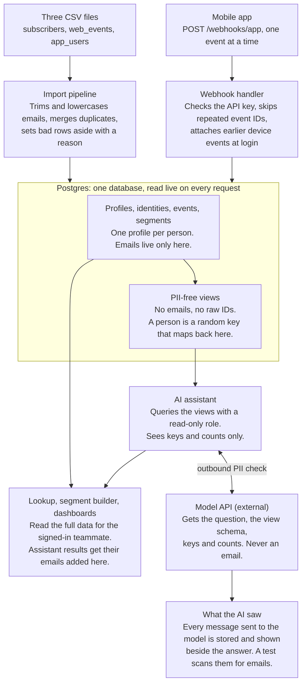

# Mini CDP — Build Plan

Oct 12, 2026 · Jacob Roman

## Summary

The recommended build is one Next.js app on Vercel with a Postgres database: a single deploy serves the UI, the API and `POST /webhooks/app`. Framework, UI and storage are decided: Next.js, Tailwind, shadcn/ui and Postgres on Neon.

One idea carries all five requirements. Every identifier (email, web visitor ID, app user ID, device ID) points to one profile, and every web visit and app event lands on one activity timeline. Lookup, segments, the webhook and the assistant all read that model live, so a new event shows up on the next request with no restart and no re-import.

Three places where reviewers will look hardest, and where the plan spends its effort:

- **The messy data.** Handled visibly: an import report shows every row merged or set aside, and why.
- **Webhook correctness.** Duplicates and out-of-order delivery are proven safe by a test that replays shuffled events and checks the end state is identical.
- **The PII wall.** Enforced by the database, not by a prompt: the assistant's database role cannot read the email column at all.

## App structure: People at the core

The product is split the way Planning Center splits its suite: People is the one place a person lives, and every other app stores its own activity and points at a person by ID.

| App | Owns | How it reaches a person |
| --- | --- | --- |
| **People** | The person record, every identifier (email, visitor ID, user ID, device ID), lookup, segments | It is the source; the others ask it |
| **Newsletter** | Subscription status, source, signup date, last open (the beehiiv data) | By email |
| **Web** | Site visits and UTM sources | By visitor ID |
| **Mobile** | App accounts, devices, webhook events | By user ID or device ID |
| **Assistant** | Questions, answers, the audit trail | Through PII-free views only |

Rules that keep the split honest:

- **One door into People.** Other apps call People's functions (`findOrCreatePerson`, `linkIdentifier`, `mergePeople`) or its API. They never write its tables.
- **One folder per app:** `src/apps/people`, `newsletter`, `web`, `mobile`, `assistant`. Each holds its own tables, functions, routes and tests. Shared helpers live in `src/shared`.
- **One API namespace per app,** such as `/api/people/v1/people`, so the data is usable elsewhere without the UI.

### Engineering rules

- **Tests for everything:** every function and every route has a test.
- **Small functions that do one thing,** named for what they do.
- **DRY:** shared logic, such as email normalising and identity linking, is written once and called from every app.
- **Basic constructs:** plain functions and plain data, no clever abstractions.

## What the data looks like

The files are clean in format (ISO dates, no broken rows) and messy in identity: the traps are all about matching the same person across files.

| File | Rows | Contents | Mess found |
| --- | --- | --- | --- |
| `subscribers.csv` | 2,995 | Email, signup date, status, source, last open date | 8 fully blank rows; 2 invalid emails (`not-an-email`, `@gmail.com`); 85 duplicate pairs that differ only by letter case or padding spaces |
| `web_events.csv` | 10,000 | 2,028 visitors across 16 pages, 30 Jun to 28 Sep 2026 | Email on only 1,400 rows, always on `/subscribe`, 212 of them upper-case; UTM empty on 80% of rows; UTM says `twitter` where subscribers say `X` |
| `app_users.csv` | 930 | User ID, email, created date | 94 emails in upper or mixed case; 30 `appuserN@gmail.com` accounts match no subscriber |

After cleaning there are 2,900 unique subscribers: 2,610 active and 290 unsubscribed. 470 of them have never opened.

What the matching rule is worth:

- **Exact string match** links 806 app accounts and 1,190 web signups. **Trim and lowercase** links 900 and 1,400.
- **Linking the whole visitor, not just the row.** Only 1,400 web rows carry an email, but attaching every visit from those visitor IDs brings in 8,441 of the 10,000 visits: 1,931 before signup and 5,110 after.
- **Left anonymous:** 628 visitors with 1,559 visits never gave an email. 197 of them viewed `/subscribe` and left.

Coverage across the 2,900 subscribers: 1,400 have web history, 900 have an app account, 431 have both, 1,034 have neither.

Two details that shape the design:

- The webhook sample's story slug (`supreme-court-ruling-explained`) matches a web path (`/news/supreme-court-ruling-explained`). App reads and web visits can be tied to the same story.
- The webhook sample's `u_2b6447a3` is a real row in `app_users.csv` and resolves to an active Instagram subscriber. It makes a good end-to-end demo case.

## Architecture and stack

One deploy and one database: fewer moving parts leaves more time for the five requirements.

| Layer | Choice | Why |
| --- | --- | --- |
| Framework | Next.js (App Router, TypeScript) | UI, API routes and the webhook in one codebase and one deploy |
| Hosting | Vercel | Named in the brief; HTTPS and environment secrets with no setup |
| Database | Postgres on Neon | Real SQL for segments, unique constraints for dedupe, roles and views for the PII wall |
| Schema and queries | Drizzle | Typed schema and migrations, plain SQL where it reads better |
| UI | Tailwind and shadcn/ui | A clean interface, fast |
| Validation | Zod | One schema each for the webhook payload and segment rules |
| AI | Gemini API, free tier | Free to run; any model with tool calling fits the design |
| Tests | Vitest | Import counts, webhook replay, PII scan |

Both sources write to one Postgres database. People read the full data; the assistant reads only the PII-free views, and every call to the model passes an outbound check and is logged.

The design does not depend on this stack. The same tables, linking rules and PII layers carry over to Laravel, Rails or anything else that runs on Postgres.

## Data model and identity resolution

Decided: one Postgres database on Neon with one schema per app, and a raw layer kept beside it. Emails and every other identifier live only in the `people` schema; every other app stores a person ID and nothing identifying.

| Schema | Table | One row per | Holds |
| --- | --- | --- | --- |
| `raw` | `subscribers`, `web_events`, `app_users`, `webhook_events` | Row exactly as the source sent it | Source values untouched, plus an outcome: loaded, merged or set aside, and why |
| `people` | `people` | Person | Random person key and created date. Kind (subscriber, app-only, unknown app user) is worked out from what the other apps hold |
| `people` | `identifiers` | Email, visitor ID, user ID or device ID | Type, normalised value, person, how and when it was linked |
| `people` | `segments` | Saved segment | Name, rule definition as JSON |
| `newsletter` | `subscriptions` | Person's newsletter subscription | Status, source, signup date, last open date |
| `web` | `visits` | Page view | Visitor ID, person if known, page, time, UTM source |
| `mobile` | `accounts` | App account | User ID, person, created date |
| `mobile` | `events` | Webhook event | Unique event ID, event name, user ID, device ID, person if known, event time, received time, properties |
| `assistant` | `audit` | Assistant request | Question as sent, every tool call and result the model saw |
| `ai` | Views only | Person, visit or event, with identifiers removed | The only objects the assistant's database role can read |

Three layers keep the mess contained:

- **Raw** is what each source said, never edited. The Import report reads its outcome columns, and cleaning rules can be re-run when they change.
- **People** is who we believe each person is. It is the only place identity is decided.
- **App tables** are what each person did, keyed by person ID.

A `timeline` view unions `web.visits` and `mobile.events` into one stream per person. Lookup and segments read that view. "Profile" in the sections below means one row in `people.people`.

Why one database rather than one per app: segments join across apps, and device stitching needs one transaction. The schemas keep the boundaries, so an app can move to its own database later behind People's API.

Linking rules:

1. **Email is the join key**, compared after trim and lowercase. No Gmail dot or plus-tag folding: it changes nothing in this data and can merge two real people.
2. **Duplicate subscribers merge into one profile.** On conflict: earliest signup date, latest open date, `unsubscribed` beats `active`. No pair conflicts in this file; the rule is there for the next import.
3. **A web visitor ID belongs to a profile** once any of its visits carries a matching email. All of its visits attach, earlier and later.
4. **An app user ID resolves** through `app_users.csv` to an email, then to a profile. The 30 accounts with no subscriber get an app-only profile.
5. **A device ID belongs to a user** from its first logged-in event. A user ID never seen before gets a placeholder profile, merged into the real one if the account shows up later.
6. **Channel names are normalised once.** `X` and `twitter` are one channel; an empty UTM on a first visit is `Direct`.

Anonymous visitors and devices that never log in keep their events, unattached, so funnels still count them.

## Requirements 1 to 3: import, lookup, segments

### 1. Pulls it together

An import script loads the three files in one transaction and is safe to re-run. An Import report page shows what happened to every row. These counts are the acceptance test:

| Check | Expected |
| --- | --- |
| Subscriber profiles | 2,900 |
| Duplicate rows merged | 85 |
| Rows set aside | 10 (8 blank, 2 invalid email) |
| App accounts linked to a subscriber | 900 |
| App-only profiles | 30 |
| Web visits attached to a subscriber | 8,441 |
| Web visits left anonymous | 1,559 |

### 2. Finds anyone

One search box takes an email (partial is fine), user ID, visitor ID or device ID. The profile page shows:

- **Newsletter:** status, source, signup date, last open, days since last open.
- **Identity:** every linked ID and how it was linked.
- **Timeline:** web visits and app events merged by event time, filterable by source.
- **App:** account created date, devices, event counts by type.

### 3. Builds a segment

A rule builder joins filters with AND / OR over a fixed catalog of fields. A live count updates as rules change; segments can be saved and exported as CSV.

- **Fields:** source, status, signup date, last open (date, days since, never), has app account, web visits (count, last visit, viewed page), app events (type, count, within N days), engagement tier.
- **One engine:** rules are stored as JSON and compiled to parameterised SQL on the server. The assistant emits the same JSON, so the builder and the assistant cannot disagree.
- **Always live:** counts are computed at request time, so webhook events change them at once.

Decided defaults:

- **All statuses.** A segment covers active and unsubscribed people unless a status filter is added.
- **Never opened counts as not opened.** "No open in N days" includes people who never opened, and each of those rows carries a Never opened tag.

Benchmark for the brief's example, "signed up from Instagram and haven't opened in 30 days": 229 people. 146 carry the Never opened tag; 83 opened at least once and then lapsed.

## Requirement 4: the webhook

`POST /webhooks/app` writes each event to the same `events` table the UI reads, so it appears on the next page load. There is no cache to warm and nothing to restart.

Request handling, in order:

1. **Check the API key.** Failure returns 401.
2. **Validate the shape:** `event` is one of the four names, `timestamp` is ISO, `user_id` may be null. Failure returns 400 with field errors, and the payload goes to a rejects log.
3. **Insert on the unique `event_id`.** A repeat returns 200 with `duplicate: true` and changes nothing.
4. **Resolve identity,** then re-run stitching for that device.
5. **Return 200** with the profile key the event landed on.

| Case | Handling |
| --- | --- |
| Same event twice | Unique index on `event_id`; the second insert is a no-op |
| Events out of order | Event time and received time are stored separately. Every read sorts by event time; "last seen" is a max, never "latest received" |
| Device logs in after anonymous events | The first event carrying both IDs links device to user. Every unattached event on that device gets the profile |
| Anonymous event arrives after its login was processed | The device link already exists, so it attaches on insert |
| User ID never seen before | A placeholder profile is created and the events attach to it |
| Known user ID that is not a subscriber | Attaches to that account's app-only profile |
| Two users on one device | By event time, anonymous events attach to the next user who logs in on that device |

The proof is a test, not a claim. It takes one event history, shuffles and duplicates it 100 different ways, replays each, and asserts the final database state is identical every time.

An Event simulator page in the UI sends events to the real endpoint. It shows anonymous events attaching at login, live, for the Loom.

## Requirement 5: the AI assistant

The model cannot leak what it cannot read: it queries the database through a role with no access to emails or raw IDs. Correct answers still come back because the app joins emails in after the model's last turn.

How one question is answered:

1. **Scrub the question.** Any email or ID the teammate typed is swapped for a placeholder that the server maps to a profile key.
2. **Call the model** with the question, today's date (2026-09-28), the schema of the PII-free views and two tools.
3. **`run_query`** runs read-only SQL over the views, for counts and tables. **`create_segment`** emits segment rule JSON; the server validates it and returns a count and a segment ID.
4. **Results sent back to the model** hold profile keys, counts, dates and page paths only.
5. **The app renders the answer for the human.** Where a result lists profile keys, emails are joined in on the server. The model never sees that table.

| Layer | What it does | What it stops |
| --- | --- | --- |
| Database role | `ai_reader` can select only from PII-free views: no email, no visitor, user or device IDs. Read-only, 5 second timeout, 1,000 row cap | A confused or prompt-injected model reading emails or writing data |
| Opaque keys | Each profile has a random key, not a hash of its email | Reversing a hashed email with a dictionary of addresses |
| Input scrub | Emails and IDs in the question become placeholders | PII typed by the teammate |
| Property whitelist | Views expose only known-safe event properties, such as the story slug | Free-text PII arriving inside webhook `properties` |
| Outbound check | Every request to the model is scanned for email patterns and known subscriber emails; a hit blocks the call | Anything the other layers missed |

Showing how it was done:

- **"What the AI saw" drawer** beside every answer: the exact messages and tool results sent to the model.
- **`assistant.audit` table** keeping the same record for every request.
- **A test in CI** that runs the brief's three questions and fails if any subscriber email appears in any outbound payload.

The brief's three questions, with the numbers the assistant should reproduce:

| Question | Output | Benchmark from the data |
| --- | --- | --- |
| How many Instagram signups went cold last month? | A number, with the definition of "cold" stated | 281 Instagram signups in August; 76 have no open in the last 30 days |
| Build me a list of our most engaged readers | A saved segment | Top engagement tier (score defined under Surprise us) |
| Which pages do new subscribers hit first? | A table | `/` 279, `/subscribe` 256, `/shadrachs-picks` 124, `/about` 112 |

Model provider: on hold. The design needs only a model that supports tool calling, and nothing in the PII layers depends on the vendor.

## Surprise us

Recommended: build the first four, and take 5 and 6 if time allows. Each one answers a question a Growth team asks weekly.

| Rank | Feature | Why Growth cares | Effort |
| --- | --- | --- | --- |
| 1 | Engagement score and lifecycle tiers | One score per reader from email recency, web visits and app activity. Powers "most engaged" and "at risk" in segments and the assistant | Medium |
| 2 | Channel quality board | Signups by source beside never-opened rate, cold rate and app adoption: volume against quality | Small |
| 3 | Segment activation | CSV export, plus a "push to beehiiv as a tag" action behind an interface. Stubbed, since there is no beehiiv account | Small |
| 4 | Live event feed and simulator | Watch events land and attach to profiles. Carries the Loom demo of requirement 4 | Small |
| 5 | Story affinity | App `read_story` slugs match web `/news/` paths, so "read this story on either surface" becomes a segment | Medium |
| 6 | Subscribe-page funnel | 2,433 subscribe-page views became 1,400 signups. Shows which sources convert and which leak | Small |
| 7 | Opportunity cards | Ready-made segments on the home page: 2,000 subscribers with no app account, 30 app users not on the newsletter | Small |
| 8 | Segment size over time | A daily snapshot per saved segment, drawn as a trend | Medium |

## Security and deployment

The UI gets a simple password gate; the webhook gets its own API keys, as it would in production.

- **One auth module, two kinds of caller.** People sign in and get a session; machines send an API key. Both go through the same `authenticate` function.
- **UI:** one shared password, checked on the server, sets a signed httpOnly cookie. Middleware guards every page and API route except the login page and the webhook. Login attempts are rate-limited.
- **Webhook (proposed, see Open questions):** `Authorization: Bearer` with an API key. Keys are created and revoked on a Settings page behind the login, shown once, stored hashed in `auth.api_keys` and limited to writing events. A 64 KB body cap and a per-key rate limit apply.
- **Database:** three roles. Owner runs migrations, `app` reads and writes, `ai_reader` sees the PII-free views only.
- **Secrets:** host environment variables. Nothing in the repo; `.env.example` lists the names.
- **Logs:** event IDs and profile keys, never emails.
- **"Today":** one setting, `CDP_TODAY=2026-09-28`, read by segments and the assistant. Unset, it falls back to the real clock.
- **Hosting:** Vercel for the app, Neon for Postgres. The import runs once as a script against production.
- **For reviewers:** the URL, the UI password, an API key and a curl command that sends a sample event.

## Build order

Each step ends with a check against a number from the data, so progress is provable rather than eyeballed.

1. **Scaffold, schema, import pipeline, Import report.** Check: the seven counts under requirement 1.
2. **Lookup and profile page.** Check: `u_2b6447a3` shows newsletter, web and app activity in one view.
3. **Engagement score, segment engine, builder UI.** Check: Instagram plus 30 days returns 229, with 146 tagged Never opened.
4. **Webhook, stitching, Event simulator.** Check: the shuffle-and-duplicate replay test passes, and a new event changes lookup and a segment count with no redeploy.
5. **Assistant with the PII wall.** Check: the three sample questions return the benchmark numbers, and the outbound scan finds no emails.
6. **Password gate and deploy.** Check: smoke test of all five requirements on the live URL.
7. **Extras:** channel quality board, export and beehiiv stub, live feed.
8. **README and Loom outline:** design decisions, trade-offs, what comes next with more time.

Progress: steps 1 to 6 are built and tested (import, lookup, segments, webhook, assistant on the Gemini API free tier, and the password login gate). The engagement score from step 3 is not built yet.

## Open questions

- [x] **Stack:** decided. Next.js, Tailwind and shadcn/ui, organised as a People app with other apps around it.
- [x] **Storage:** decided. One Postgres database on Neon with a schema per app.
- [x] **Raw layer:** decided. Keep an untouched copy of every source row in the database.
- [x] **Repo location:** decided. A new repo under `/Volumes/Passport/www`.
- [x] **Segment default:** decided. All statuses.
- [x] **"Haven't opened in 30 days":** decided. Includes people who never opened, tagged Never opened.
- [ ] **Webhook auth:** building as proposed unless you say otherwise. The login guards a Settings page where API keys are made, and the mobile app sends one of those keys.
- [ ] **Repo name and visibility:** `mini-cdp` created under www. Public or private on GitHub?
- [x] **AI provider:** Google Gemini API free tier (`gemini-3.8-flash`, falling back to `gemini-3.5-flash-lite`).
- [ ] **Time budget:** the deadline and hours available decide how far down the extras list to go.
